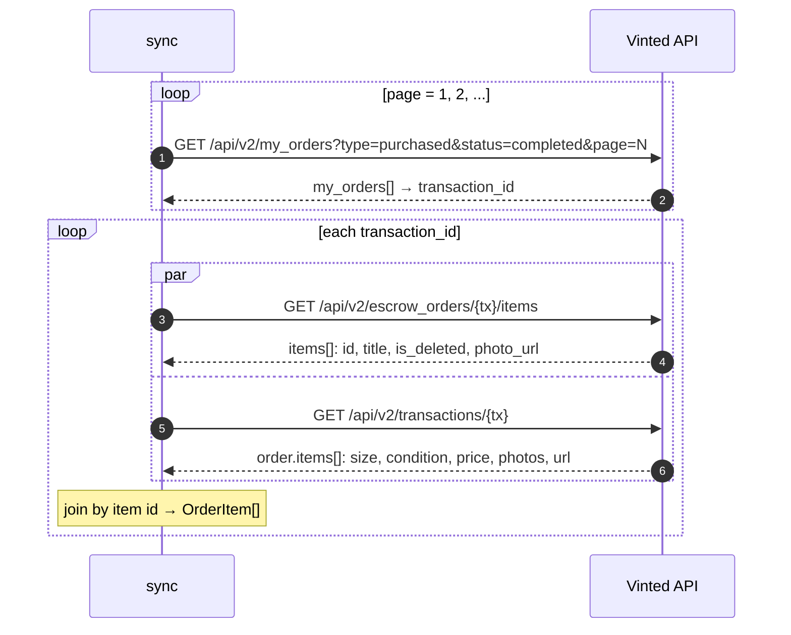

# How purchased items are fetched from Vinted

Code: `vinted/account/orders/api.py` (`fetch_my_orders` → `build_order`).

## Item fields

| Field | Source |
|---|---|
| `id`, `title`, `is_deleted`, `photo_url` | `escrow_orders/{tx}/items` |
| `size`, `condition` | `transactions/{tx}` → `size_title`, `status` |
| `listed_price` | `transactions/{tx}` → `price` (in PLN) |
| `url`, `catalog_id`, `photo_urls` | `transactions/{tx}` |
| `paid_price` | `escrow_orders/{tx}/items` → `paid_price_in_seller_currency` — **`null` since ~2026-09** |
